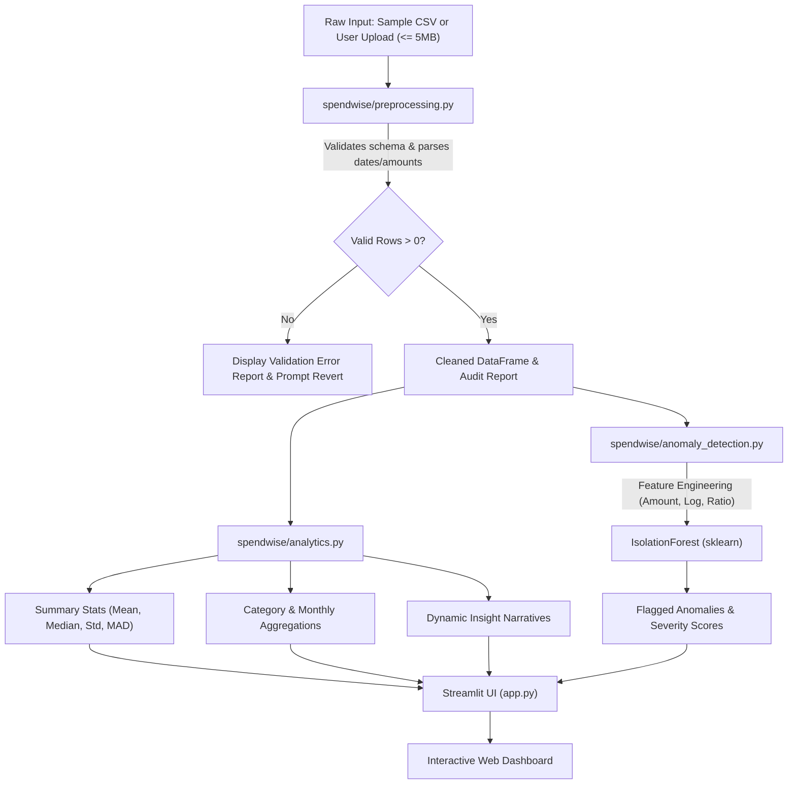

# SpendWise: Smart Expense Analyzer & ML Anomaly Detector

> **An educational, production-ready personal expense intelligence dashboard powered by Python, Streamlit, Pandas, NumPy, and scikit-learn.**

---

## 1. Project Title & Overview

**SpendWise** is a lightweight, beginner-friendly machine learning web application that transforms raw personal expense CSV records into actionable financial intelligence. 

Instead of overwhelming users with black-box enterprise architectures or synthetic simulations, SpendWise implements genuine mathematical and statistical computations alongside an unsupervised **Isolation Forest** machine learning model. It immediately highlights spending distributions, category shares, period trends, and statistically elevated transactions while providing intuitive, human-understandable explanations.

SpendWise comes pre-packaged with a verified sample dataset spanning January through April 2026, allowing recruiters, evaluators, and end users to experience the application instantly without preparing or uploading data first.

---

## 2. Problem Statement

Managing personal finances often leaves people asking fundamental questions:
- *Where does my money actually go each month?*
- *Which category dominates my wallet share?*
- *Are certain transactions unusually large or abnormal compared to my routine spending habits?*

Traditional personal finance tools either rely on rigid manual budgeting rules or advertise "AI" that is little more than a marketing wrapper around static heuristics. Conversely, enterprise anomaly detection software is far too complex for students and developers seeking to understand the core mathematics.

**SpendWise solves this dilemma:**
1. It provides an immediate visual summary of personal cash outflows.
2. It bridges descriptive statistics (Mean, Median, Standard Deviation, Median Absolute Deviation) with genuine unsupervised machine learning (`IsolationForest`).
3. It clearly educates users that an anomaly is simply a statistical rarity—not an accusation of financial fraud or an infallible prediction.

---

## 3. Features

- **Instant Zero-Setup Demonstration:** Automatically loads a bundled deterministic dataset of 117 transactions so the application is rich and interactive on first launch.
- **Custom CSV Upload & Validation:** Safely processes user-uploaded CSV files up to 5 MB with thorough schema validation, date parsing, and non-positive amount rejection.
- **Transparent Rejection Reporting:** Never silently discards rows; provides a detailed audit log showing why any rows were excluded.
- **Reset to Sample Data:** Return to the default demonstration dataset at any time with a single click.
- **Interactive Multi-Filter Ledger:** Search descriptions, multi-select categories, filter by calendar date ranges, and sort by amount or date.
- **Visual Analytics with Plotly:** Interactive donut charts for category shares and multi-period line trends with formatted currency tooltips.
- **Data-Driven Spending Insights:** Dynamic analytical narratives derived directly from the active numbers (Wallet share %, transaction frequency, distribution skewness, MoM trajectory).
- **Unsupervised Anomaly Detection:** Real scikit-learn `IsolationForest` detecting unusual expenses using a 3-feature representation (`amount`, `log_amount`, `category_amount_ratio`).
- **Interactive Sensitivity Tuning:** User-adjustable contamination slider (1% to 15%) to tune how conservatively or aggressively the model flags transactions.
- **Statistical MAD Baseline:** Calculates an upper spending threshold using Median Absolute Deviation ($Median + 3 \times 1.4826 \times MAD$) as an explainable non-parametric benchmark.
- **Educational Model Walkthrough:** Dedicated section explaining isolation trees, decision functions, unsupervised vs. supervised paradigms, and human-in-the-loop validation.

---

## 4. Screenshots & Visual Walkthrough

> *To add screenshots to your repository, capture images of your running application, save them into a `docs/screenshots/` folder, and reference them below.*

```text
+------------------------------------------------------------------------------------+
|  [Sidebar]                  SpendWise: Smart Expense Analyzer                      |
|  - Active: Sample Data      [Overview] [Transactions] [Insights] [Anomaly] [About]  |
|  - Upload Custom CSV        -----------------------------------------------------  |
|  - Reset to Sample          Total Spend       Transactions   Average       Max     |
|  - Sensitivity (5%)         $428,315.00       117            $3,660.81     $145k   |
|                             -----------------------------------------------------  |
|                             [ Donut Chart: Categories ]   [ Monthly Trend Line ]   |
+------------------------------------------------------------------------------------+
```

1. **Dashboard Overview:** Displays high-level KPIs, interactive Plotly category breakdowns, and monthly spend trajectories.
2. **Transaction Ledger:** Live search and multi-criteria filtering for individual expenses.
3. **Anomaly Inspection:** Scatter plot pinpointing flagged transactions with severity scores and contextual explanations.

---

## 5. Technology Stack & Design Rationale

| Technology | Version | Purpose & Rationale |
| :--- | :--- | :--- |
| **Python** | `3.11+` | Core programming language offering excellent readability and data science library support. |
| **Streamlit** | `^1.30.0` | Powers the web frontend and user interface entirely in pure Python without needing Node.js or React. |
| **Pandas** | `^2.0.0` | High-performance DataFrame operations, CSV ingestion, data cleaning, and category aggregations. |
| **NumPy** | `^1.24.0` | Vectorized numerical operations, log transformations, and Median Absolute Deviation calculations. |
| **scikit-learn** | `^1.3.0` | Provides the production-grade `IsolationForest` implementation for unsupervised anomaly detection. |
| **Plotly** | `^5.18.0` | Generates responsive, interactive charts (donut breakdowns, line trends, anomaly scatter plots). |
| **pytest** | `^7.4.0` | Automated test suite verifying data validation, mathematical edge cases, and model reproducibility. |

*Why no database or external APIs?*
SpendWise was intentionally architected without external dependencies like PostgreSQL, Redis, LangChain, or paid LLM APIs. This guarantees zero recurring costs, lightning-fast execution, complete data privacy, and effortless deployment to free cloud tiers.

---

## 6. Architecture & Data Flow

SpendWise follows a modular functional design where each layer has a single, testable responsibility:



---

## 7. Project Folder Structure

```text
spendwise/
├── .gitignore                   # Ignores venvs, cache, and OS artifacts
├── .streamlit/
│   └── config.toml              # Streamlit UI theme and 5MB upload size configuration
├── data/
│   └── sample_expenses.csv      # Bundled deterministic dataset (117 expenses, Jan-Apr 2026)
├── pytest.ini                   # Pytest test discovery and pythonpath configuration
├── requirements.txt             # Minimal pinned dependencies
├── README.md                    # Complete technical and deployment documentation
├── app.py                       # Streamlit UI presentation and application orchestration
├── spendwise/                   # Core business logic package
│   ├── __init__.py              # Package initializer (v1.0.0)
│   ├── preprocessing.py         # Schema verification, type conversion, and row validation
│   ├── analytics.py             # Descriptive statistics, MAD threshold, and insights
│   └── anomaly_detection.py     # Feature engineering and Isolation Forest model
└── tests/                       # Automated test suite
    ├── test_preprocessing.py    # Tests for missing columns, corrupt rows, and imputations
    ├── test_analytics.py        # Tests for statistical aggregations and MAD baseline
    └── test_anomaly_detection.py# Tests for ML model flags, reproducibility, and edge cases
```

---

## 8. CSV Schema & Format Specification

When uploading your own expense records, the CSV file must contain the following four column headers (case-insensitive):

| Column | Data Type | Requirement | Description & Example |
| :--- | :--- | :--- | :--- |
| `date` | String / Date | Required | Transaction date in standard format (`YYYY-MM-DD`). E.g., `2026-02-14`. |
| `description` | String | Optional | Description of the purchase. Blank values default to `"Uncategorized Expense"`. |
| `category` | String | Optional | Spending bucket (e.g., `Food & Dining`, `Housing`, `Shopping`). Blank values default to `"Other"`. |
| `amount` | Numeric | Required | Strictly positive expense amount ($> 0$). Zero and negative values are rejected. E.g., `1250.50`. |

### Example Valid CSV:

```csv
date,description,category,amount
2026-01-02,Supermarket Weekly Groceries,Food & Dining,2150.00
2026-01-03,Metro SmartCard Recharge,Transportation,500.00
2026-01-05,Monthly Apartment Rent,Housing,16000.00
2026-01-09,Streaming Subscription,Entertainment,499.00
2026-01-31,Emergency Dental Surgery,Healthcare,28000.00
```

---

## 9. Local Installation Instructions

SpendWise requires **Python 3.11** or **Python 3.12**.

### Windows (PowerShell)

```powershell
# 1. Clone your repository
git clone https://github.com/<your-username>/spendwise.git
cd spendwise

# 2. Create a virtual environment
python -m venv .venv

# 3. Activate the virtual environment
.\.venv\Scripts\Activate.ps1

# 4. Upgrade pip and install dependencies
python -m pip install --upgrade pip
pip install -r requirements.txt
```

### macOS / Linux (Bash or Zsh)

```bash
# 1. Clone your repository
git clone https://github.com/<your-username>/spendwise.git
cd spendwise

# 2. Create a virtual environment
python3 -m venv .venv

# 3. Activate the virtual environment
source .venv/bin/activate

# 4. Upgrade pip and install dependencies
python -m pip install --upgrade pip
pip install -r requirements.txt
```

---

## 10. How to Run the Streamlit Application

With your virtual environment activated, run:

```bash
streamlit run app.py
```

Streamlit will launch a local web server and open your browser automatically:
- **Local URL:** `http://localhost:8501`
- **Network URL:** `http://<your-lan-ip>:8501`

To stop the application at any time, press `Ctrl + C` in your terminal.

---

## 11. Using the Application

### Using the Built-In Sample Dataset
When you first open SpendWise, the application automatically loads `data/sample_expenses.csv`. You will see:
- 117 verified expenses spanning January 1, 2026 to April 30, 2026.
- Total spending of \$428,315.00 with realistic categories (Food & Dining, Housing, Utilities, Transportation, Healthcare, Shopping, Entertainment).
- Pre-identified anomalies including an emergency dental procedure, a developer workstation laptop, a major vehicle transmission overhaul, and a luxury vacation.

### Uploading a Custom CSV
1. Expand the left sidebar.
2. Drag and drop your `.csv` file into the **Upload Custom CSV** widget (or click "Browse files").
3. SpendWise will validate your file in real time. If any rows are invalid (e.g. non-numeric amounts or unparseable dates), an expander will appear detailing the exact number of excluded rows.
4. The dashboard charts, insights, and ML model instantly update to reflect your personal data.

### Resetting Back to Sample Data
Click the **🔄 Reset to Sample Data** button in the sidebar. This clears session uploads and immediately restores the default demonstration.

---

## 12. Statistical Analysis Explained

### 1. Mean vs. Median & Distribution Skewness
- **Mean (Arithmetic Average):** $\bar{x} = \frac{1}{N} \sum_{i=1}^{N} x_i$. The mean divides the total spend evenly. However, it is heavily susceptible to extreme outlier purchases. A single \$145,000 laptop purchase drastically raises the average, misrepresenting typical daily expenses.
- **Median (50th Percentile):** The middle value when expenses are sorted in ascending order. If $N$ is even, it is the average of the two middle numbers. The median represents the typical transaction because extreme values at either end do not change the central rank.
- **Skewness Ratio:** When $\frac{\text{Mean}}{\text{Median}} > 1.25$, SpendWise classifies the spending distribution as **right-skewed**, warning the user that a handful of large transactions are disproportionately driving up the average.

### 2. Robust Outlier Baseline: Median Absolute Deviation (MAD)
Traditional outlier detection uses $\text{Mean} \pm 3\sigma$. However, because standard deviation ($\sigma$) squares deviations from the mean, an extreme outlier inflates $\sigma$, causing other elevated expenses to be hidden (the *masking effect*).

Instead, SpendWise implements **Median Absolute Deviation (MAD)**:
$$\text{MAD} = \text{median}\left(|x_i - \text{median}(X)|\right)$$

For normally distributed data, standard deviation can be estimated consistently as:
$$\hat{\sigma} = 1.4826 \times \text{MAD}$$

SpendWise computes an explainable statistical cutoff threshold:
$$\text{Threshold} = \text{Median} + (3 \times 1.4826 \times \text{MAD})$$

*Edge Case Handling:* If more than 50% of transactions share the exact same amount (such that $\text{MAD} = 0$), SpendWise automatically falls back to sample standard deviation or median scaling, ensuring the threshold never collapses to zero.

---

## 13. Machine Learning: Isolation Forest Explained

SpendWise employs `sklearn.ensemble.IsolationForest`, an unsupervised algorithm designed specifically for anomaly detection.

### Core Mathematical Intuition
Traditional clustering algorithms attempt to identify what constitutes "normal" behavior (profiling dense clusters). **Isolation Forest turns this concept upside down: it explicitly isolates anomalies.**

1. **Random Recursive Partitioning:** The model constructs an ensemble of 100 Isolation Trees (`iTrees`). For each tree, it recursively splits the data by randomly choosing a feature and selecting a random split point between that feature's minimum and maximum values.
2. **Path Length Difference:**
   - **Normal instances** reside in dense clusters. They require many recursive cuts to separate into individual leaf nodes (resulting in a **long path length**).
   - **Anomalies** reside in sparse, extreme feature regions. They become isolated near the root of the tree in just a few random cuts (resulting in a **short path length**).

### Features Supplied to the Model
To ensure clarity and avoid black-box obscurity, SpendWise uses exactly three intuitive features:
1. `amount`: The raw dollar value of the transaction.
2. `log_amount`: $\ln(1 + \text{amount})$. Financial expense distributions are almost universally right-skewed. Taking the natural logarithm compresses extreme values, preventing a \$100k purchase from drowning out smaller variations.
3. `category_amount_ratio`: $\frac{\text{amount}}{\text{category\_median} + 10^{-4}}$. Context matters. Spending \$2,000 on rent is completely normal; spending \$2,000 on lunch is highly anomalous. This ratio provides context-aware anomaly scoring.

---

## 14. Interpreting Anomaly Scores & Sensitivity

### The Decision Function & Raw Score
Under scikit-learn's Isolation Forest implementation:
- `model.predict(X)` outputs:
  - `+1`: Normal inlier.
  - `-1`: Flagged anomaly.
- `model.decision_function(X)` outputs the anomaly score:
  - **Positive scores:** The transaction required deeper trees to isolate; it is considered normal.
  - **Negative scores:** The transaction was isolated near the tree root; it is flagged as an anomaly.
  - **The more negative the score, the more isolated and unusual the transaction.**

### Severity Score (0 to 100)
Raw negative decimals can be confusing for non-technical users. SpendWise normalizes the inverted decision scores onto a transparent $0 - 100$ scale:
- `0 - 40`: Normal, routine expenses.
- `41 - 70`: Elevated or borderline expenses.
- `71 - 100`: High-severity statistical anomalies requiring user review.

### Anomaly Sensitivity (Contamination Slider)
The sidebar slider allows users to adjust the model's **contamination parameter** between **1% and 15%** (default 5%):
- **Lower Sensitivity (e.g., 1% – 3%):** The model is conservative, flagging only the most glaring, extreme transactions.
- **Higher Sensitivity (e.g., 8% – 15%):** The model becomes aggressive, flagging borderline transactions that deviate moderately from category norms.

---

## 15. Model Limitations & Privacy Considerations

### Important Limitations
1. **Unsupervised Nature:** Isolation Forest does not know whether an expense was authorized, fraudulent, or accidental. It only knows whether an expense is *statistically rare* within the given feature space.
2. **Context Blindness:** A planned annual expense (such as university tuition, home insurance, or flight tickets) will be flagged as an anomaly purely because of its rarity and magnitude.
3. **No Ground Truth Accuracy Claims:** In unsupervised learning, metrics like Accuracy, Precision, Recall, and ROC-AUC cannot be calculated without human-annotated ground-truth labels. SpendWise does not invent fabricated accuracy percentages.
4. **Sample Size:** Isolation Forest performs best with at least 30–50 transactions. Datasets with fewer than 5 transactions are flagged as insufficient.

### Data Privacy
- SpendWise runs **100% locally in your browser and Python runtime**.
- No expense data, merchant names, or bank account figures are ever transmitted to third-party APIs, cloud databases, or LLMs.
- Session uploads reside strictly in ephemeral memory and are discarded when the browser session terminates.

---

## 16. Automated Testing

SpendWise includes a test suite covering preprocessing, statistical calculations, and machine learning models using `pytest`.

### Running All Tests

From the repository root:

```bash
python -m pytest
```

### Verbose Test Execution

```bash
python -m pytest -v
```

### What the Test Suite Verifies:
1. **Data Cleaning (`test_preprocessing.py`):**
   - Verification of required schema (`date`, `description`, `category`, `amount`).
   - Rejection of invalid dates, non-numeric strings, negative amounts, and zero amounts.
   - Proper imputation of missing descriptions (`"Uncategorized Expense"`) and categories (`"Other"`).
   - Robust error handling for completely empty files or files containing 0 valid rows.
2. **Statistical Analytics (`test_analytics.py`):**
   - Accurate arithmetic totals, mean, median, min, and max.
   - Edge case handling for single-transaction datasets ($N=1$ with zero division guards).
   - Category breakdown percentages strictly summing to $100\%$.
   - Chronological monthly aggregation and Month-over-Month percentage changes.
   - Robust MAD calculation and graceful fallback when $\text{MAD} = 0$ (constant values).
   - Dynamic spending insight card generation.
3. **Machine Learning (`test_anomaly_detection.py`):**
   - Correct shape and non-null values for engineered features.
   - Accurate identification of synthetic extreme outliers (e.g., \$15k, \$25k).
   - Deterministic reproducibility guaranteed by fixed `random_state=42`.
   - Sensitivity slider behavior (higher contamination flags equal or more items).
   - Edge cases: Small datasets ($N < 5$) and zero-variance constant datasets.

---

## 17. Free Live Deployment Guide (Streamlit Community Cloud)

You can deploy SpendWise publicly for free on **Streamlit Community Cloud** in under 5 minutes.

### Prerequisites
- A free [GitHub Account](https://github.com/).
- A free [Streamlit Community Cloud Account](https://share.streamlit.io/) linked to your GitHub.

### Step-by-Step Deployment Instructions

1. **Push your code to GitHub:**
   Ensure your local repository is pushed to a public or private GitHub repository (see [Section 18](#18-github-publishing-guide)).
   Verify that `app.py`, `requirements.txt`, and `data/sample_expenses.csv` are committed.

2. **Open Streamlit Community Cloud:**
   Navigate to [share.streamlit.io](https://share.streamlit.io/) and log in with your GitHub credentials.

3. **Create a New App:**
   - Click the blue **"Create app"** button.
   - Select **"I already have an app"**.

4. **Configure Deployment Settings:**
   - **Repository:** Select your `spendwise` repository (e.g. `your-username/spendwise`).
   - **Branch:** Select `main`.
   - **Main file path:** Enter `app.py`.
   - **App URL:** (Optional) Customize your app subdomain (e.g. `spendwise-analytics.streamlit.app`).

5. **Deploy:**
   - Click **"Deploy!"**.
   - Streamlit will automatically read `requirements.txt`, install dependencies, and launch your application.

6. **Verify the Live Deployment:**
   - Once the build log displays "Ready", open the deployed URL in a new browser tab.
   - Verify that the **sample dataset loads automatically** without requiring any file upload.
   - Test uploading a custom CSV and adjusting the anomaly sensitivity slider.

### Free Tier Notes & Limitations
- **Sleeping Behavior:** Free Streamlit Cloud apps will automatically sleep after several days of inactivity to conserve resources. Visiting the URL wakes the application in ~15 seconds.
- **Resource Limits:** Standard free apps receive 1 GB of RAM and 1 shared vCPU, which is more than sufficient for SpendWise's lightweight footprint.

---

## 18. GitHub Publishing Guide

### Suggested Commit Sequence

```bash
# 1. Initialize git if not already initialized
git init

# 2. Add all project files
git add .

# 3. Create your initial commit
git commit -m "feat: initial commit of SpendWise personal expense analyzer"

# 4. Rename default branch to main
git branch -M main

# 5. Add your GitHub remote repository
git remote add origin https://github.com/<your-username>/spendwise.git

# 6. Push to GitHub
git push -u origin main
```

### Automatic Updates
Whenever you push new commits to your `main` branch on GitHub:
```bash
git add .
git commit -m "feat: update dashboard styling and charts"
git push origin main
```
Streamlit Community Cloud will automatically detect the commit, pull changes, and redeploy your live application with zero downtime.

---

## 19. Common Errors & Troubleshooting

| Issue | Likely Cause | Solution |
| :--- | :--- | :--- |
| `ModuleNotFoundError: No module named 'spendwise'` | Python path does not include the project root when running tests. | Run pytest using `python -m pytest` or verify `pytest.ini` exists with `pythonpath = .`. |
| `ValidationError: Missing required column(s)` | Uploaded CSV headers do not match expected column names. | Ensure your CSV includes `date`, `description`, `category`, and `amount` (case-insensitive). |
| `Uploaded file exceeds 5MB size limit` | File size is larger than the configured Streamlit limit. | Compress or truncate the CSV file to stay within 5 MB. |
| Plotly charts appear blank or squeezed | Small browser viewport or CSS container conflict. | Maximize your browser window or click the expand button on the chart. |
| Streamlit Cloud deployment build fails | Version conflict in `requirements.txt`. | Ensure package versions match the flexible ranges specified in this repository's `requirements.txt`. |

---

## 20. Future Improvements

While SpendWise is intentionally kept minimal and accessible, potential extensions include:
- **Receipt OCR Ingestion:** Integrating Tesseract or a local computer vision model to extract transaction data from scanned receipts.
- **Categorization via NLP:** Using a lightweight Naive Bayes or TF-IDF classifier to suggest categories for unlabeled expense descriptions.
- **Budgeting Threshold Alerts:** Allowing users to set custom monthly spending ceilings per category with visual progress bars.
- **Multi-Currency Support:** Adding currency symbol selection and automatic exchange rate conversion.

---

## 21. License

This project is licensed under the **MIT License** — you are free to use, modify, and distribute this codebase for educational and personal projects.
